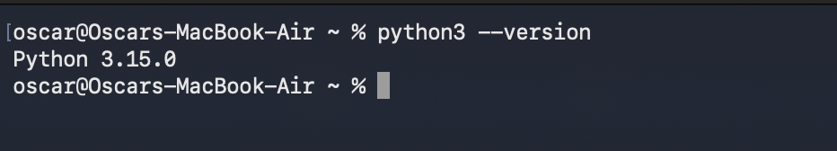
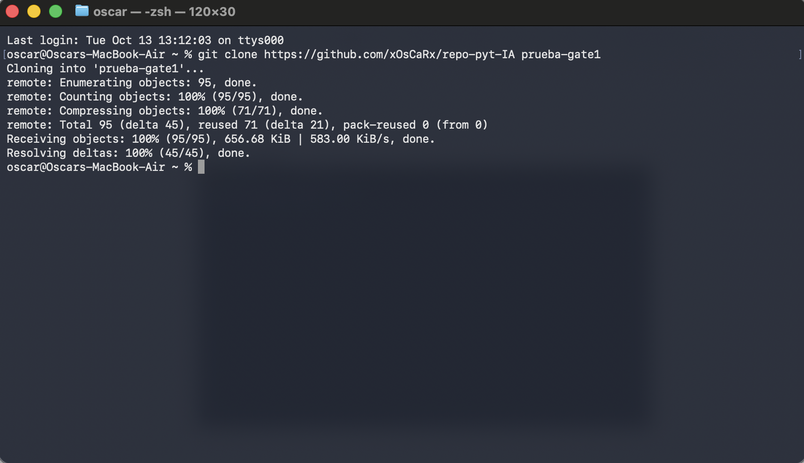
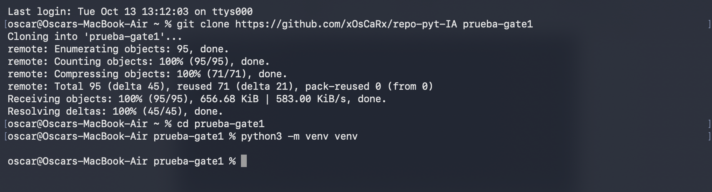
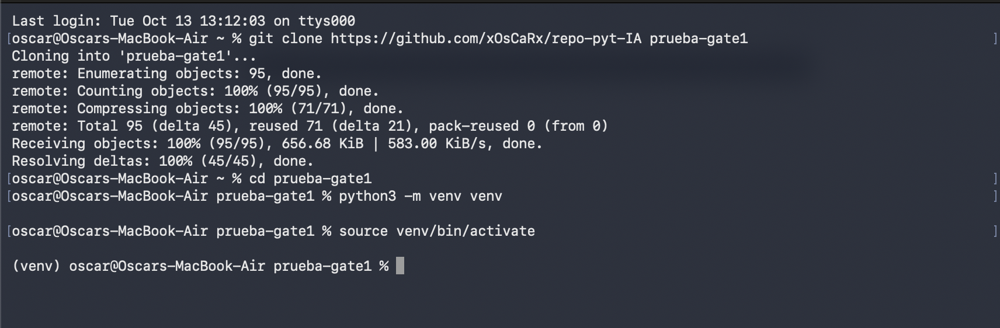
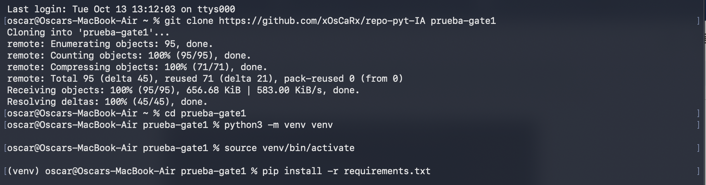
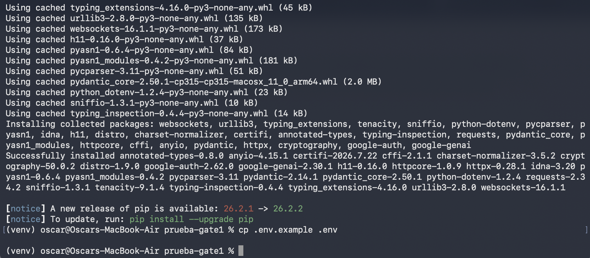
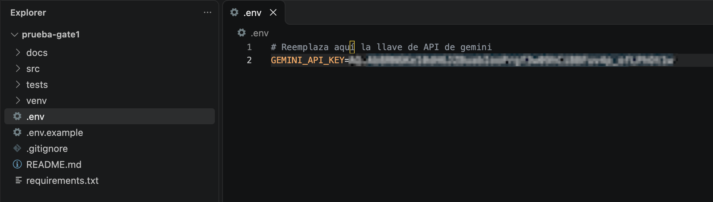
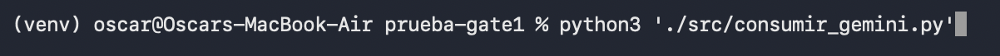
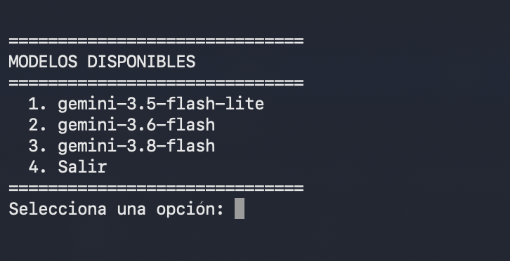

# Proyecto IA — Consultor de gestión de proyectos con Gemini

Aplicación de consola en Python para consultar a un asistente de inteligencia artificial especializado en **gestión de proyectos de software**. Permite trabajar con modelos de **Google Gemini** y solicitar análisis para apoyar decisiones sobre riesgos, alternativas y recuperación de proyectos.

Sigue los pasos en orden para descargarlo, instalarlo y ejecutarlo en **macOS o Linux**.

> **Importante:** necesitarás conexión a Internet y una **clave de API de Gemini**. La aplicación realiza consultas a un servicio externo. El uso de la API puede estar sujeto a cuotas o costos según tu cuenta y modelo.

## 1. Requisitos previos

Necesitas lo siguiente:

| Requisito | Para qué se utiliza | Cómo comprobarlo |
|---|---|---|
| **Python 3.10 o superior** | Ejecutar la aplicación | `python3 --version` |
| **Git** | Descargar el código desde GitHub | `git --version` |
| **Conexión a Internet** | Descargar las dependencias y consultar Gemini | Comprueba que tienes acceso a Internet |
| **Clave de API de Gemini** | Autorizar las consultas a Gemini | Consulta el apartado 6 |
| **Terminal** | Ejecutar los comandos de instalación | Terminal en macOS/Linux, o terminal integrada de VS Code |

### 1.1. Comprueba Python

Abre **Terminal** y ejecuta:

```bash
python3 --version
```

El resultado debe indicar una versión compatible, por ejemplo `Python 3.12.x`. **El número exacto puede ser diferente.** Si el comando no existe o tu versión es inferior a 3.10, instala una versión compatible desde [python.org/downloads](https://www.python.org/downloads/) y vuelve a abrir Terminal.



### 1.2. Comprueba Git

```bash
git --version
```

Si aparece un número de versión, puedes continuar. Si no tienes Git, consulta las instrucciones oficiales de [instalación de Git](https://git-scm.com/downloads). 

## 2. Descarga el proyecto

### 2.1. Elige dónde guardar los archivos

En Terminal, ve a la carpeta en la que quieras guardar el proyecto. Por ejemplo, la carpeta `Documents` de tu usuario:

```bash
cd ~/Documents
```

Para comprobar tu ubicación actual, puedes usar `pwd`. Si prefieres otra carpeta, entra en ella con `cd`.

### 2.2. Clona el repositorio

Copia **exactamente** este comando en Terminal:

```bash
git clone https://github.com/xOsCaRx/repo-pyt-IA.git prueba-gate1
```

Git creará una nueva carpeta llamada **`prueba-gate1`** en la ubicación elegida.



### 2.3. Entra en la carpeta del proyecto

**Este paso es importante:** los siguientes comandos se deben ejecutar *dentro* de la carpeta clonada.

```bash
cd prueba-gate1
```

Puedes verificarlo con:

```bash
pwd
ls -a
```

Deberías ver, entre otros archivos, `requirements.txt`, `.env.example` y la carpeta `src/`.

## 3. Crea un entorno virtual de Python

Un entorno virtual mantiene las librerías de esta aplicación separadas de las de otros proyectos.

**Crea el entorno:**

```bash
python3 -m venv venv
```



**Actívalo:**

```bash
source venv/bin/activate
```



Al activarse, suele aparecer `(venv)` al comienzo de la línea de Terminal. Para confirmarlo de forma más precisa:

```bash
which python
```

La ruta debería terminar en `prueba-gate1/venv/bin/python` (la parte inicial de la ruta depende de tu equipo).

> Si cierras Terminal, el entorno virtual dejará de estar activo. Para volver a utilizar la aplicación, entra en `prueba-gate1` y ejecuta nuevamente `source venv/bin/activate`. **No necesitas crear el entorno de nuevo.**

## 4. Instala las dependencias

Con el entorno virtual **activado** y desde la carpeta `prueba-gate1`, ejecuta:

```bash
python -m pip install -r requirements.txt
```

Espera a que termine. Este comando instala las librerías indicadas en `requirements.txt` dentro del entorno virtual.



Si el comando finaliza sin errores, puedes continuar.

## 5. Crea tu archivo de configuración

El proyecto utiliza un archivo `.env` para mantener la clave de Gemini separada del código.

Ejecuta:

```bash
cp .env.example .env
```



Para comprobar que se creó:

```bash
ls -a
```

Deberías ver tanto `.env.example` como `.env`. **El punto inicial forma parte del nombre** y es normal que estos archivos estén ocultos en algunos exploradores de archivos.

## 6. Configura tu clave de API de Gemini

1. Abre [Google AI Studio](https://aistudio.google.com/) con tu cuenta de Google y accede a la sección de claves de API.
2. Crea u obtén una clave habilitada para utilizar la API de Gemini, según las opciones de tu cuenta.
3. Abre el archivo `.env` del proyecto con un editor de texto, por ejemplo VS Code.
4. Reemplaza **solo** `tu_llave_aqui` por tu clave real y guarda el archivo.

El formato debe ser el siguiente:

```dotenv
GEMINI_API_KEY=tu_clave_real_aqui
```



**No cambies** el nombre `GEMINI_API_KEY`. No agregues espacios alrededor de `=` y evita copiar comillas o caracteres adicionales por accidente.

> **Seguridad:** tu clave es secreta. No la publiques en GitHub, capturas de pantalla, mensajes ni documentación. El archivo `.env` no debe subirse al repositorio. Si expones una clave por accidente, revócala o rótala desde el servicio donde la creaste.

## 7. Ejecuta la aplicación

Comprueba que sigues dentro de `prueba-gate1` y que el entorno virtual está activo. Luego ejecuta:

```bash
python3 "./src/consumir_gemini.py"
```





Deberías ver un menú como el de la imagen. Sigue las instrucciones y selecciona una opción.

### Cómo volver a ejecutar el proyecto otro día

Una vez terminada la instalación, **no tienes que clonar ni instalar todo nuevamente**. Basta con ingresar a la carpeta donde clonaste el proyecto, activar tú entorno y ejecutar la aplicación:

```bash
cd ~/[Carpeta_con_proyecto_clonado]/prueba-gate1
source venv/bin/activate
python src/consumir_gemini.py
```


Para salir del entorno virtual después de usar la aplicación:

```bash
deactivate
```

## 8. Solución de problemas frecuentes

| Mensaje o problema | Causa probable | Cómo solucionarlo |
|---|---|---|
| `python3: command not found` | Python no está disponible en Terminal | Instala Python desde [python.org](https://www.python.org/downloads/), vuelve a abrir Terminal y ejecuta `python3 --version`. |
| `git: command not found` | Git no está instalado o no está disponible | Instala Git desde [git-scm.com](https://git-scm.com/downloads) y vuelve a intentar. |
| `fatal: destination path 'prueba-gate1' already exists` | Ya existe una carpeta con ese nombre | Si ya clonaste el proyecto, usa `cd prueba-gate1`. No borres la carpeta sin revisar su contenido. |
| `No such file or directory: requirements.txt` | Estás en la carpeta equivocada | Ejecuta `pwd` y `ls -a`. Luego entra en `prueba-gate1` y repite la instalación. |
| `source: no such file or directory: venv/bin/activate` | No se creó `venv` en la carpeta actual | Entra en la raíz del proyecto y ejecuta `python3 -m venv venv`, luego `source venv/bin/activate`. |
| `No module named pip` | `pip` no está disponible en el intérprete utilizado | Comprueba que el entorno está activado y ejecuta `python3 -m ensurepip --upgrade`.  |
| `ModuleNotFoundError` | Falta una dependencia o se está usando otro Python | Activa `venv` y repite `python -m pip install -r requirements.txt`. |
| `.env.example: No such file or directory` | No estás en la raíz del proyecto o el archivo falta | Comprueba `pwd` y `ls -a`; confirma que el archivo existe en el repositorio descargado. |
| Error de clave o autenticación con Gemini | Clave ausente, incorrecta o sin acceso | Revisa `.env`, especialmente `GEMINI_API_KEY`, guarda los cambios y comprueba que la clave sea válida en Google AI Studio. |
| Error `429` | Límite de solicitudes o cuota de la API | Revisa las cuotas y restricciones de tu cuenta. Reintenta cuando corresponda; si la cuota se agotó, puede ser necesario esperar su renovación. |
| Error `500` o `503` | Problema temporal del servicio externo | Vuelve a intentar más tarde. Si persiste, revisa el mensaje exacto y el estado del servicio. |
| `can't open file 'src/consumir_gemini.py'` | La ruta no existe en la carpeta actual | Comprueba que estés en la raíz con `pwd` y que el archivo exista mediante `ls src`. |
|


## 9. Estructura de carpetas

```text
prueba-gate1/
├── README.md            # Este documento
├── src/                 # Código fuente
├── docs/                # Documentación técnica
├── tests/               # Pruebas del proyecto
├── img/                 # Capturas utilizadas en este README
├── requirements.txt     # Dependencias de Python
├── .env.example         # Plantilla sin credenciales reales
├── .env                 # Configuración local, no subir a Git
├── .gitignore           # Archivos excluidos del repositorio
└── venv/                # Entorno virtual local, no subir a Git
```

Las carpetas `venv/` y el archivo `.env` se crean durante la instalación; no vienen necesariamente en el repositorio. La carpeta `img/` **debe incluirse en el repositorio si quieres que las capturas del README sean visibles para otras personas**.

## 10. Buenas prácticas de seguridad

- No incluyas claves, contraseñas o tokens en el código fuente.
- Nunca subas `.env` ni `venv/` a GitHub.
- Usa `.env.example` solo como plantilla, sin secretos.
- Revisa `git status` antes de hacer commit o push.
- No compartas capturas de pantalla que muestren credenciales reales.

---

**Repositorio:** [github.com/xOsCaRx/repo-pyt-IA](https://github.com/xOsCaRx/repo-pyt-IA)

**Guía compatible para:** macOS y Linux. Esta guía no incluye instrucciones para Windows.
